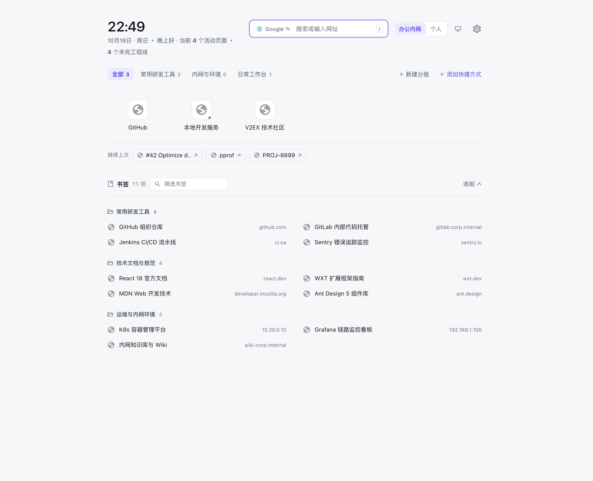
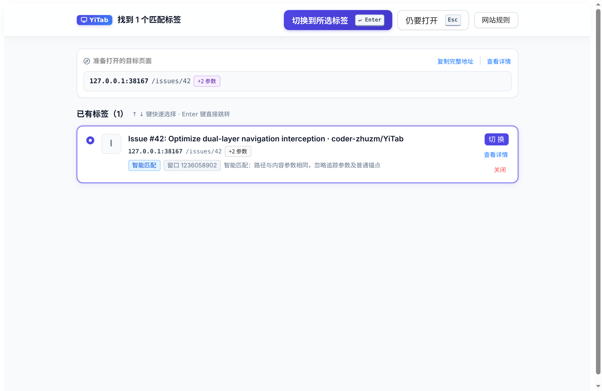
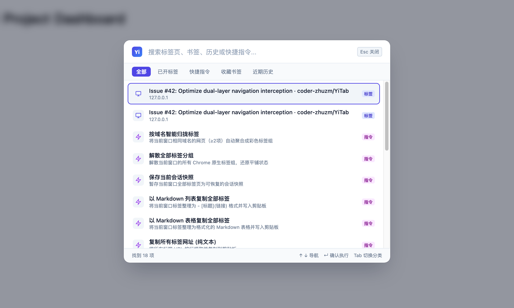
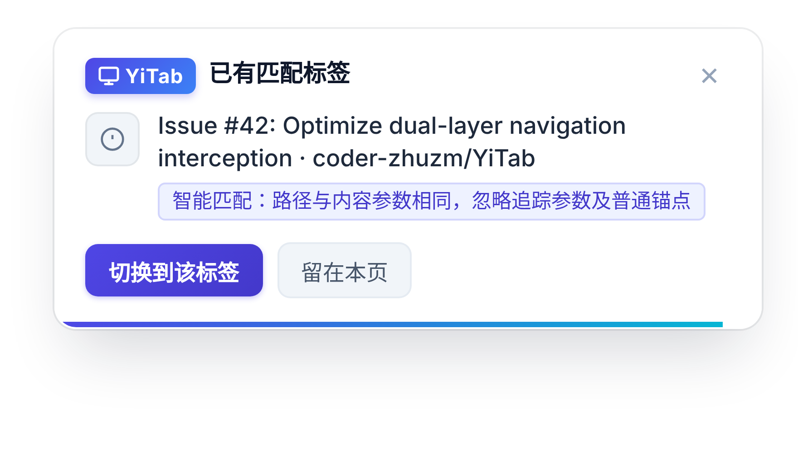
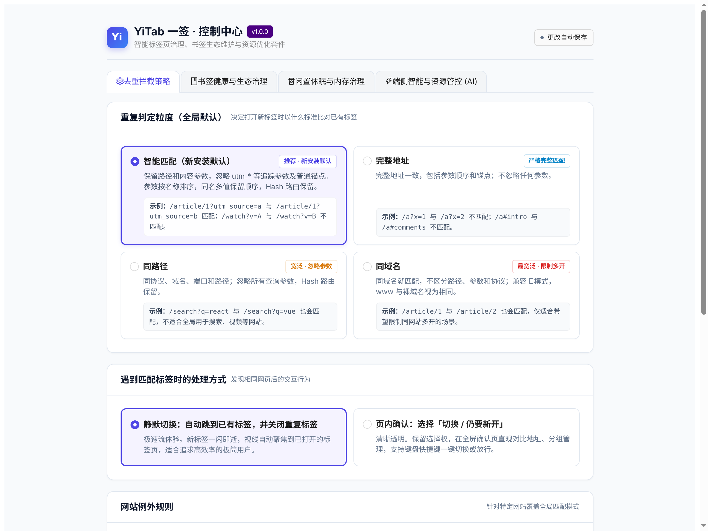

# YiTab 一签

<p align="center">
  <strong>优雅、轻量的 Chrome 标签页生命周期、新标签页直达与书签生态治理套件</strong>
</p>

<p align="center">
  <a href="https://github.com/coder-zhuzm/YiTab/releases"></a>
  <a href="https://developer.chrome.com/docs/extensions/develop/migrate"></a>
  <a href="https://react.dev"></a>
  <a href="https://wxt.dev"></a>
  <a href="./LICENSE"></a>
</p>

---

## 解决痛点

在日常研发与办公中，标签页总在不知不觉中堆积数十甚至上百个：
- **重复打开**：点击外部链接、聊天窗口或书签时，反复打开早已存在的工单、PR、控制台或文档，白白浪费内存与寻找时间。
- **直达繁琐**：想打开内网服务或特定端口（如 `localhost:8080`、`10.x.x.x`、`.corp`），浏览器地址栏频繁误跳至公共搜索引擎。
- **内存堆积**：大量闲置标签持续霸占系统资源，浏览器越用越卡。
- **书签混乱**：日积月累的收藏夹充斥着重复副本与失效参数，查找成本极高。

**YiTab 一签** 为此而生：打造无感且强大的标签页生命周期与书签治理工作流。

---

## 核心特性

### 1. 新标签页极速直达工作台 (New Tab Smart Launcher)
> 接管 Chrome 空白页，打造首屏冷启动 < 30ms 的高效极简直达面板。

<p align="center">
  
</p>

- **内网与端口免搜索直达**：智能识别私有 IPv4、`localhost`、`[::1]`、内网 TLD（`.corp`、`.oa`、`.lan`）及特定端口，回车直接导航。
- **“猜你想开”与恢复微胶囊**：基于访问频次、衰减模型与当前时段自适应推选；针对工单/PR等深层路径自动生成「继续上次」微胶囊。
- **书签全景直展矩阵**：按文件夹目录平铺展开常用书签，支持毫秒级关键字即时检索。
- **会话现场一键唤醒**：底部自动感知上次沉淀的工作快照，支持一键在后台批量恢复所有关联标签。
- **全键盘极速聚焦**：任意位置按 `/` 键秒级聚焦搜索框，按 `Esc` 快速失焦。

---

### 2. 标签去重与无感拦截 (Tab Deduplication)
> 从源头杜绝相同页面多开，支持静默聚焦切换与吸顶确认管理。

<p align="center">
  
</p>

- **双层拦截架构**：兼顾普通整页跳转（网络提交前拦截）与单页应用内部无刷新路由（Shadow DOM 轻量浮窗），保护当前输入状态。
- **智能参数归一化**：自动剔除 `utm_*`、`gclid`、`fbclid` 等追踪噪音，精准识别内容参数与前端路由 Hash。
- **Hash 路由默认保留**：`#inbox` 与 `#sent` 这类单段 Hash 路由不会被误判为同一页面；纯文档站可切换为「忽略 Hash」，把 `#intro`、`#comments` 视作页内锚点。
- **站内路由不抢焦点**：单页应用内点击链接时默认只弹页内轻提示，绝不夺走你正在输入的页面；也可改为静默切换或完全不处理。
- **全键盘极速流**：按 `Enter` 切换至已有标签，按 `Esc` 原地继续打开，支持一键将重复标签归拢至 Chrome 原生标签组。

---

### 3. 标签治理、内存优化与端侧智能

| 模块 | 能力说明 |
| :--- | :--- |
| **标签智能聚合** | 一键将当前窗口的杂乱标签按域名归类为调色板命名的 Chrome 标签组，支持一键解散还原。 |
| **闲置休眠省内存** | 调用 Chrome 原生 discard 接口释放后台闲置标签内存（严防播放音视频与固定标签误伤）。 |
| **会话快照与导出** | 一键将当前窗口标签沉淀为持久化会话快照，支持导出为 Markdown 列表、表格或 JSON。 |
| **书签智能去重体检** | 递归全树扫描重复书签，结合目录深度与标题完整度智能推荐最佳保留项，支持清理前自动快照防丢与标准 HTML/JSON 备份。 |
| **端侧 AI (Gemini Nano)** | 接入浏览器原生端侧大模型，100% 离线隐私推理；严格守住即用即毁、LRU 缓存与低电量自动挂起等五大资源防线。 |

---

## 界面速览

<table align="center">
  <tr>
    <td align="center" width="50%">
      
      <br /><strong>全局命令面板 (Alt+K / Cmd+K)</strong>
    </td>
    <td align="center" width="50%">
      
      <br /><strong>工具栏控制中心 (Popup)</strong>
    </td>
  </tr>
  <tr>
    <td align="center" width="50%">
      
      <br /><strong>SPA 路由轻量浮窗 (Shadow DOM)</strong>
    </td>
    <td align="center" width="50%">
      
      <br /><strong>规则与端侧智能配置中心 (Options)</strong>
    </td>
  </tr>
</table>

---

## 快捷键指南

| 场景 | 快捷键 | 功能说明 |
| :--- | :--- | :--- |
| **任意网页** | <kbd>Alt+K</kbd> / <kbd>Cmd+K</kbd> | 唤出 Spotlight 风格全局命令面板，即时搜索标签、书签、历史与执行指令 |
| **Chrome 地址栏** | 输入 <kbd>tab</kbd> + <kbd>Space</kbd> | 激活 Omnibox 搜索建议，输入关键字回车快速切换至已有标签 |
| **新标签页** | <kbd>/</kbd> | 秒级聚焦全能聚合搜索框；按 <kbd>Esc</kbd> 失焦 |
| **新标签页** | <kbd>↑</kbd> / <kbd>↓</kbd> | 在智能建议列表（已开标签/快捷跳转）中上下循环切换选择 |
| **新标签页** | <kbd>↵ Enter</kbd> | 直接激活并切换至选中的已开标签（未选中时执行搜索或网址直达） |
| **拦截确认页** | <kbd>↵ Enter</kbd> | 立即激活并切换至选中的已有标签页 |
| **拦截确认页** | <kbd>Esc</kbd> | 忽略拦截并在当前标签页中继续打开新页面（8 秒智能防回流） |
| **拦截确认页** | <kbd>↑</kbd> / <kbd>↓</kbd> | 在找到的多个候选已有标签页之间切换选择 |
| **拦截确认页** | <kbd>Delete</kbd> | 快速关闭当前选中的已有标签页 |

---

## 匹配模式规范

| 模式 | 判定维度 | 参数处理 | 适用场景 |
| :--- | :--- | :--- | :--- |
| **智能匹配 (Smart)** *(默认)* | 协议 + 域名 + 端口 + 路径 + 内容参数 + Hash | 剔除 `utm_*` 等营销参数，保留有效业务参数 | 绝大多数日常网页与研发协作 |
| **完整地址 (URL)** | 完整 URL 字符串 | 严格保留所有参数顺序、大小写、`www.` 与锚点 | 对查询参数顺序敏感的特殊系统 |
| **同路径 (Path)** | 协议 + 域名 + 端口 + 路径 + Hash | 忽略所有 URL 查询参数 | 需限制单一文章或单功能页面多开 |
| **同域名 (Domain)** | 主机域名（Host） | 仅按域名校验，忽略端口与路径 | 限制单一站点全站仅保留单个活动标签 |

> **生效优先级**：`全局白名单` > `具体网站自定义规则` > `全局默认模式`。
>
> **Host 处理**：`smart` / `path` / `url` 模式下，`www.example.com` 与 `example.com` 是**两个不同站点**，默认不合并 —— 自动合并会扩大判定范围，把原本放行的两个页面判为重复。若确实需要合并，为裸域添加一条站点规则即可（此时 `www.` 子域会命中该规则；反向不成立）。`domain`（同域名）模式保留其「整站合并」语义。
>
> **Hash 策略**：默认 `保留`，因为 `#inbox` / `#sent` 这类单段 Hash 常被单页应用用作路由；无法自动区分「单段路由」与「页内锚点」，因此默认取保守侧（宁可漏判，不可误判）。若站点只用 Hash 做页内锚点，可在控制中心切换为 `忽略`（该开关为**全局**设置）。

---

## 安装与使用

### 方式一：下载预构建包（推荐）
1. 前往 [Releases 页面](https://github.com/coder-zhuzm/YiTab/releases) 下载最新版本的 `yitab-x.x.x-chrome.zip` 并解压。
2. 打开 Chrome，访问 `chrome://extensions/`。
3. 开启右上角 **「开发者模式」**。
4. 点击左上角 **「加载已解压的扩展程序」**，选择解压出的目录即可。

### 方式二：从源码构建
开发构建依赖 **Node.js 22.6+** 与 **npm**：

```bash
git clone https://github.com/coder-zhuzm/YiTab.git
cd YiTab
npm ci            # 安装依赖
npm run dev       # 开发模式（热重载）
npm run build     # 编译打包 Chrome MV3 产物（输出至 .output/chrome-mv3/）
```

---

## 技术架构

- **核心框架**：[WXT](https://wxt.dev/)（新一代 Chrome MV3 原生 Vite 扩展框架）
- **UI 界面**：React 18 + TypeScript (Strict Mode) + Ant Design 5 (Token 风格定制)
- **隔离机制**：Shadow DOM 样式强隔离（SPA 浮窗 & 全局命令面板）
- **测试保障**：151 项原生单元测试（100% 通过）+ Headless Chromium 自动化端到端截屏管线

---

## 隐私与合规

YiTab 严格遵守 Google Chrome Web Store 开发者计划政策及最小权限原则：
- **100% 本地运行**：绝不上报、收集、传输或出售任何用户的浏览历史、书签及敏感数据。
- **隐私权政策**：详见 [PRIVACY.md](./PRIVACY.md) 或在线访问 [privacy.html](./docs/privacy.html)。
- **Chrome 网上应用店资料指南**：详见 [CHROME_STORE_LISTING.md](./docs/CHROME_STORE_LISTING.md)。

---

## 开源许可

本项目基于 [MIT 许可证](./LICENSE) 开源。
