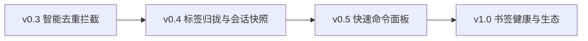

# YiTab 一签

<p align="center">
  <strong>轻量、无侵入的 Chrome 标签页去重与效率管理套件</strong>
</p>

<p align="center">
  <a href="https://github.com/coder-zhuzm/YiTab/releases"></a>
  <a href="https://developer.chrome.com/docs/extensions/develop/migrate"></a>
  <a href="https://react.dev"></a>
  <a href="https://wxt.dev"></a>
  <a href="./LICENSE"></a>
</p>

---

## 概述

在多任务浏览场景中，用户常因点击外部链接、打开书签或在地址栏输入而重复打开已经存在的网页，导致浏览器标签页迅速堆积。

**YiTab 一签** 在浏览器底层网络与路由事件中进行非侵入式去重检测：
- **无重复标签**：完全静默放行，零额外耗时，保持浏览器原生体验。
- **检测到重复**：
  - **静默切换（默认）**：自动聚焦至已存在的标签页，新开标签瞬间自动释放。
  - **页内确认**：将重复标签转化为交互式管理面板，直观对比目标网址与已有标签，支持一键切换、全键盘快捷操作或加入标签组。

---

## 界面展示

### 1. 拦截确认页（Committed Navigation）
当从地址栏、书签、快捷键或外部应用打开重复网页时，自动呈现聚焦确认界面。吸顶操作栏确保操作按钮始终触手可及，配合等宽 URL 结构高亮与物理按键提示。

<p align="center">
  
</p>

### 2. 单页应用路由浮窗（SPA In-Page Toast）
针对 GitHub、Jira、各类控制台等现代前端单页应用（SPA）的内部无刷新路由跳转，通过隔离的 Shadow DOM 挂载浮窗提示，既避免重复进入相同内容，又绝不刷新或中断当前网页的 DOM 状态与表单输入。

<p align="center">
  
</p>

### 3. 规则配置中心（Options Center）
采用 2×2 交互式矩阵呈现四种匹配粒度（智能 / 完整 URL / 同路径 / 同域名），提供精准的代码示例与直观效果说明，支持域名白名单与细粒度网站例外规则配置。

<p align="center">
  
</p>

### 4. 标签归拢与会话快照（Extension Popup）
点击浏览器工具栏图标即可唤出控制面板：一键按域名智能聚拢当前窗口标签至 Chrome 原生彩色标签组、暂存与恢复多份会话快照，或以 Markdown 列表、Markdown 表格、纯文本及 JSON 结构极速复制导出。

<p align="center">
  
</p>

### 5. 全局命令面板与聚合检索（Command Palette）
在任意网页随时使用全局快捷键 <kbd>Alt+K</kbd>（Mac 下为 <kbd>Cmd+K</kbd>）即可唤出 Spotlight 风格命令面板。支持对跨窗口已开标签、书签、浏览历史及常用生产力指令（如“归拢标签”、“保存快照”）进行即时模糊检索与全键盘聚焦执行。

<p align="center">
  
</p>

---

## 核心特性

- **双层拦截架构**：
  - **整页导航拦截**（`webNavigation.onCommitted`）：在文档网络提交前进行拦截与重定向，避免重复下载页面资源。
  - **单页路由监听**（`onHistoryStateUpdated` / `onReferenceFragmentUpdated`）：通过内容脚本 Shadow DOM 浮窗提示，保护现有页面上下文。
- **可解释性匹配引擎**：
  - 智能过滤营销追踪参数（`utm_*`、`gclid`、`fbclid` 等）。
  - 精准识别页面内锚点与前端路由 Hash（保留 `#/path`、`#!/route`，忽略 `#comment` 锚点）。
  - 界面实时展示匹配原因、目标地址剖析与生效规则来源。
- **原生 Chrome 标签组联动**：
  - 在确认页可将重复标签及当前目标直接归拢至指定调色板颜色的 Chrome 标签组，或加入当前窗口的现有分组。
  - 支持一键按主域名自动聚合当前窗口同类标签。
- **全局命令面板与极速导航**：
  - 快捷键 <kbd>Alt+K</kbd> / <kbd>Cmd+K</kbd> 唤出轻量毛玻璃交互面板，跨标签、书签、历史毫秒级模糊匹配。
  - 深度适配 Chrome Omnibox：地址栏输入 `tab + 空格` 即可直接过滤并跳转活动标签。
- **全键盘极速流**：
  - 确认页完整支持键盘快捷键：`↵ Enter`（切换至所选）、`Esc`（仍要打开）、`↑` / `↓`（选择标签）、`Delete`（关闭选定标签）。
  - 命令面板完整支持 `↑` / `↓` 移动、`↵ Enter` 确认、`Tab` 切换分类与 `Esc` 关闭。
- **精准放行机制**：
  - 点击“仍要打开”后，系统对目标 URL 与匹配特征实施短暂放行（8 秒），平滑处理 HTTP→HTTPS 重定向链，杜绝二次拦截死循环。

---

## 匹配模式规范

| 模式 | 比较维度 | 参数处理 | 适用场景 |
| :--- | :--- | :--- | :--- |
| **智能匹配 (Smart)**<br>*(默认推荐)* | 协议 + 域名 + 端口 + 路径 + 内容参数 | 自动剥离 `utm_*`、`gclid` 等追踪参数，保留内容相关参数；参数名自动排序标准化 | 绝大多数日常网页浏览与工作协作 |
| **完整地址 (URL)** | 完整 URL 字符串 | 严格保留所有参数顺序与大小写，不忽略任何参数 | 对查询参数顺序与内容极度敏感的特定系统 |
| **同路径 (Path)** | 协议 + 域名 + 端口 + 路径 | 忽略所有 URL 查询参数 | 需限制单一文章或功能页面多开的场景 |
| **同域名 (Domain)** | 主机域名（Host） | 忽略协议、端口、路径及全部参数；`www` 与裸域名视为等价 | 限制同一站点仅允许保留单个活动标签 |

> **规则生效优先级**：`全局白名单` > `最长匹配的具体网站规则` > `全局默认模式`。

---

## 快捷键指南

### 1. 拦截确认页
无需使用鼠标即可完成所有管理操作：

| 快捷键 | 功能 |
| :--- | :--- |
| <kbd>↵ Enter</kbd> | 立即激活并切换至当前选中的已有标签页 |
| <kbd>Esc</kbd> | 忽略拦截，登记放行并在当前标签页中继续打开新页面 |
| <kbd>↑</kbd> / <kbd>↓</kbd> | 在找到的多个候选已有标签页之间切换选中目标 |
| <kbd>Delete</kbd> / <kbd>Backspace</kbd> | 关闭当前选中的已有标签页 |
| <kbd>Space</kbd> | 开启/退出批量多选管理模式 |

### 2. 全局交互与命令面板
可在任意活动网页中直接使用：

| 快捷键 / 触发方式 | 功能 |
| :--- | :--- |
| <kbd>Alt+K</kbd> *(Windows/Linux)*<br><kbd>Cmd+K</kbd> *(macOS)* | 唤出全局聚焦命令面板（Command Palette），实时跨标签、书签、历史与指令搜索 |
| 地址栏输入 <kbd>tab</kbd> + <kbd>Space</kbd> | 激活 Chrome 原生 Omnibox 地址栏搜索建议，输入关键字后按回车直达标签 |
| 面板内 <kbd>↑</kbd> / <kbd>↓</kbd> | 在多源搜索结果列表之间上下切换选中项 |
| 面板内 <kbd>↵ Enter</kbd> | 立即执行当前选中项（切换至目标标签页、打开书签网址或运行指令） |
| 面板内 <kbd>Tab</kbd> | 快速循环切换结果分类（全部 / 标签页 / 快捷指令 / 收藏书签 / 近期历史） |
| 面板内 <kbd>Esc</kbd> | 关闭全局命令面板并返回原网页 |

---

## 安装与使用

### 方式一：下载预构建包（推荐）

1. 进入 [Releases 页面](https://github.com/coder-zhuzm/YiTab/releases) 下载最新版本的 `yitab-x.x.x-chrome.zip` 并解压。
2. 打开 Chrome 浏览器，访问 `chrome://extensions/`。
3. 开启右上角的 **「开发者模式」**。
4. 点击左上角 **「加载已解压的扩展程序」**，选择刚才解压出来的目录即可。

### 方式二：从源码构建

开发与构建依赖 **Node.js 22.6+** 与 **pnpm / npm**：

```bash
# 克隆仓库
git clone https://github.com/coder-zhuzm/YiTab.git
cd YiTab

# 安装依赖
npm ci

# 开发模式（支持热重载）
npm run dev

# 编译打包 Chrome MV3 生产版本
npm run build
```

构建生成的插件产物位于 `.output/chrome-mv3/`。

---

## 产品演进路线 (Roadmap)

YiTab 的长期目标是打造围绕 Chromium 标签页与书签的轻量、高效整理套件。



### 阶段一：智能去重与拦截增强 (v0.3.x) - [已发布]
- [x] 基于网络生命周期的整页导航去重拦截（Committed Navigation）
- [x] 现代单页应用无刷新路由去重（SPA History / Hash State Toast）
- [x] 2×2 粒度匹配矩阵（Smart, URL, Path, Domain）与参数归一化
- [x] 交互式拦截确认页（操作吸顶、URL 剖析、全键盘支持）
- [x] 原生 Chrome 标签组创建与归拢集成

### 阶段二：标签归类与会话快照 (v0.4.x) - [已发布]
- [x] **域名智能归拢**：一键将当前窗口的杂乱标签按域名自动聚合成对应命名的 Chrome 标签组与解散撤销
- [x] **会话快照归档 (Session Snapshot)**：一键暂存当前窗口全部标签页为命名快照，支持稍后一键恢复、查看与单项管理
- [x] **多格式导出**：支持将当前窗口/快照标签一键复制为标准 Markdown 列表、Markdown 表格、纯 URL 或 JSON 结构
- [x] **工具栏控制弹窗 (Popup)**：轻量交互面板集成标签聚合、快照中心与导出模块

### 阶段三：快速检索与命令导航 (v0.5.x) - [当前发布]
- [x] **全局命令面板 (Command Palette)**：全局快捷键唤出（`Alt+K` / `Cmd+K`），极速模糊搜索并跳转已开标签页、书签与近期历史，支持一键执行快捷指令
- [x] **Omnibox 地址栏快捷指令**：在浏览器地址栏输入 `tab + 空格` 直接过滤并聚焦目标标签或触发系统指令
- [x] **扩展弹窗快速检索**：在 Popup 控制面板集成四合一快速检索模块

### 阶段四：书签生态与数据维护 (v1.0.x)
- [ ] **书签智能去重**：扫描并标记浏览器收藏夹中重复或死链的 URL，提供安全合并建议
- [ ] **休眠与闲置清理**：标记长期未访问的不活跃标签页，提供批量清理前的安全预览与沉淀

---

## 技术架构

- **核心框架**：[WXT](https://wxt.dev/)（新一代 WebExtension 框架，MV3 原生、Vite 驱动）
- **UI 界面**：React 18 + TypeScript (Strict Mode) + Ant Design 5 (Token 主题深度定制)
- **隔离机制**：Shadow DOM 样式隔离（SPA 浮窗 & Command Palette）+ 独立 Extension 页面
- **自动化测试**：Node.js 原生测试套件（46 项核心算法用例）+ Headless Chromium 真实端到端测试（Smoke Test）+ CDP 自动截图管线

---

## 参与贡献与开源许可

欢迎提交 Issue 反馈问题或建议，欢迎贡献代码。提交代码前请确保运行：

```bash
npm test          # 运行单元测试
npm run compile   # 运行 TypeScript 类型静态检查
```

本项目基于 [MIT 许可证](./LICENSE) 开源。
