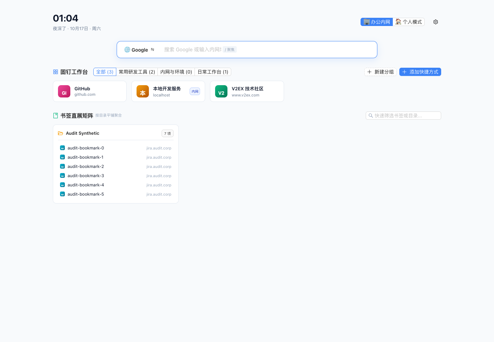
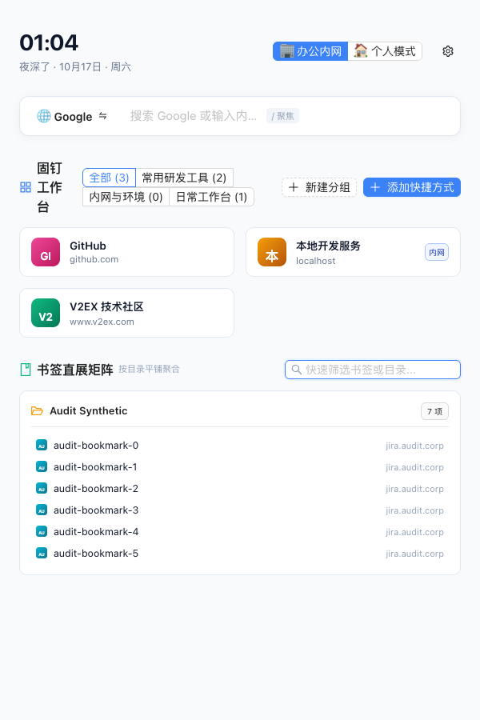
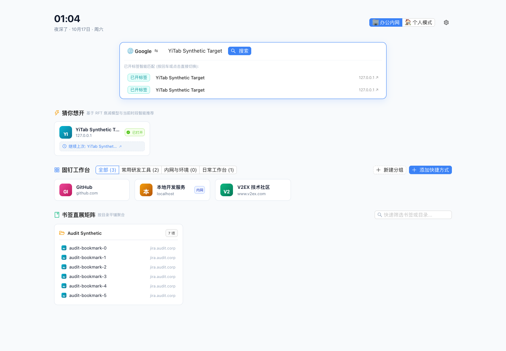
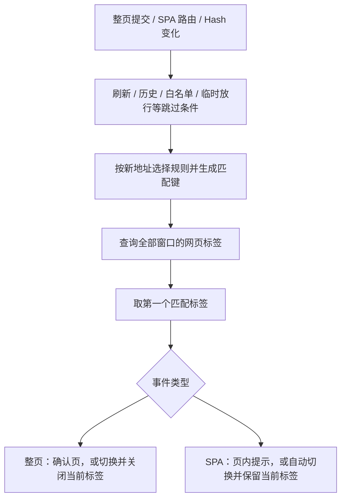

# YiTab 1.1.1 仓库检测报告与去重开发交接

评估及补充日期：2026-10-17（Asia/Shanghai）。

[Notion 在线报告](https://app.notion.com/p/3fb27a782ef681809857ef545044f9d0)。本文件为本次更新时的完整 Markdown 副本，后续不会自动与 Notion 双向同步。

> **总体结论：产品方向合理，核心路径已有可用基础，但当前版本存在会误删书签、丢失会话记录、错误关闭标签及披露站点域名的高优先级风险。建议先修复 P1，再扩展 AI 与视觉功能。**
> 类型检查、85 项单元测试、生产构建通过；经过临时环境适配的既有浏览器冒烟测试通过。这些结果不能覆盖本报告另外复现的并发和数据安全问题。

评估日期：2026-10-17（Asia/Shanghai）

评估版本：YiTab 1.1.1；分支 main；提交 `852c9225306dab7bd2a212914581c876440ac8e9`。

报告性质：代码、产品设计和运行验证的综合评估；本次未修复产品代码，未提交、推送或发布。

本页为独立私有报告，图片、测试站点、书签和标题均使用合成数据。

**阅读导航**：第 2 节总体判断；第 3–5 节 F01–F21；第 11 节去重专项；第 12 节开发交接。

# 1. 范围、方法与证据边界

## 1.1 覆盖范围

覆盖新标签页、Popup、Options、确认页、网页命令面板与 SPA 提示；检查后台导航／消息处理、URL 匹配、书签清理、快照、固定卡片、推荐、地址解析、搜索、端侧 AI、权限、依赖和发布工作流。阅读相关测试与产品／隐私说明，交叉检查“承诺—实现—测试”。

采取分工审查加主线复核：核心逻辑与界面审查各自产出独立清单，主线实际复跑关键函数并执行浏览器验证，对安全、并发、隐私与 AI 异常路径追加二次复核。使用 notion-research-documentation、React best-practices 与完整交互链路验证指导；只采用与 React 18 和 MV3 扩展相符的规则。本地未安装 self-review、verification-before-completion 这两个指定名称的 skill，未冒称调用；实际采用独立复核和先证据后结论。

**实际进行过外部检索**：Chrome 官方 API 与生命周期文档、W3C/WAI 交互规范、Tab Session Manager、nightTab 及 GitHub 安全公告。当前没有可调用的 grok-search，使用可用 Web 工具检索。社区项目只用于设计对照，没有对其做同深度审计，也不代表其完全无缺陷。

## 1.2 证据等级与严重程度

- **B：浏览器实测**。Chrome for Testing 148.0.7778.96，独立临时 profile，构建后的真实 MV3 扩展，本地合成页面和书签。
- **F：函数级复现**。Node v24.22.0 调用实际源码函数；Chrome API 使用可控内存 mock。并发 mock 的读取返回独立克隆，标签查询、激活与删除反映实时列表。不能把这类证据称为已在所有浏览器稳定重现。
- **S：静态确认**。检查完整调用链或全仓引用，代码路径可直接确定；尚未用真实用户环境触发。
- **R：设计风险／建议**。基于产品意图与实现边界提出，不当作已发生故障。

P1：可能造成数据／工作状态损失或违反明确隐私承诺，优先修复。P2：功能不完整、行为错误或重要可靠性／可访问性缺陷。P3：体验、测试工程及文档一致性问题。本次无充分证据判为 P0。

## 1.3 实际验证结果

| 检查 | 结果 | 解释 |
| :--- | :--- | :--- |
| 锁定安装 npm ci | 通过 | 使用任务临时 npm 缓存，未改 package 或 lockfile |
| npm run compile | 通过 | 完整安装后重新执行，无 TS 错误 |
| npm test | 85 通过、0 失败 | 原有用例；主要覆盖纯函数与顺序调用 |
| npm run build | 通过 | WXT 0.20.27；产物约 1 MB；共享块 568.38 KB 有体积警告 |
| 既有 browser-smoke | 临时适配后通过 | 仅改临时副本的浏览器路径和 worker 选择，仓库原脚本未改 |
| 自定义真实浏览器检查 | 完成 | 确认页、继续打开、命令面板、书签搜索、Enter、请求构造、600px 布局、同域批量创建 |
| npm audit | 12 个受影响包 | 1 low、2 moderate、6 high、3 critical；包含上游问题传播到依赖包的计数 |
| npm audit --omit=dev | 0 个已知告警 | 当前告警集中于开发工具链，不等于浏览器扩展存在 3 个可利用严重漏洞 |

首次安装未完成时的类型／构建错误已排除出最终结论。浏览器测试框架调试中出现的 URL／选择器错误也未当作产品 bug。未测试真实 Gemini Nano 推理和下载、Chrome 116、Firefox、Windows、长期运行、真实内存节省值及冷启动 30ms 的性能指标。

原始验证摘要（含合成请求列表、函数复现结果与依赖统计）：

[下载初次验证摘要](assets/yitab-audit-2026-10-17/initial-audit-evidence.json)

# 2. 对三个核心问题的直接回答

## 2.1 界面与功能设计是否合理

**总体任务拆分合理，功能范围已超过当前实现完整度。** 新标签页负责启动与找回页面，Popup 负责当前窗口操作，Options 承载长期规则，确认页解释重复匹配。这种分工清楚。“站点入口＋继续上次具体任务”的双层卡片有实际效率价值。确认页突出“切换”和“仍要打开”，并展示匹配原因与原 URL，方向正确。

主要不足是交互可信度：看起来可用的办公／个人模式和两项 AI 开关没有实际行为；界面声称 Enter 切换却进行网页搜索；书签数量与可搜索数据不一致；主要卡片缺少原生链接语义和完整键盘路径。数据治理操作缺少预览、备份和撤销，视觉上的“轻量按钮”承载了过重的后果。

## 2.2 核心逻辑是否合理

**匹配策略与模块化方向合理，跨上下文协调和破坏性操作的保障不足。** 优点包括统一标签匹配入口、保留内容参数、追踪参数剔除、复杂 Hash 保守处理、站点规则优先级、单标签导航序列号、SPA 与整页导航分流，以及归档先 await 保存再关闭。

薄弱处在边界整合：单标签序列号不能解决两个标签互相关闭；存储 API 的单次 set 不能让“读—改—写”成为事务；书签规范化与标签规范化语义不一致；批量命令绕过部分规则；恢复会话又触发去重。应先统一这些规则与协调机制，再增加推荐或 AI 能力。

## 2.3 是否有明显 bug

**有。共整理 21 项：4 项 P1、14 项 P2、3 项 P3。** 其中包括函数级复现的错误关闭／并发覆盖、真实浏览器复现的搜索与恢复冲突，以及静态可确定的空命令和空开关。下面逐项给出证据与验收条件。

# 3. P1：优先处理的四项风险

## F01 · P1 · 两个重复标签同时导航，可能被全部关闭【F】

**位置**：[src/entrypoints/background.ts:582](https://github.com/coder-zhuzm/YiTab/blob/852c9225306dab7bd2a212914581c876440ac8e9/src/entrypoints/background.ts#L582)，自动切换与关闭在 604–615 行。

**触发与证据**：默认 smart＋auto，两个相同 URL 标签同时 committed，窗口另有一个无关标签。实际后台源码注入实时内存浏览器 API，以 Promise.all 触发两个 handleNavigation，结果 removed＝\[1,2\]，remaining＝\[3\]。两个处理都先把对方视为保留对象，然后各自关闭自己。已复核 mock 的 query/get/update/remove 均反映实时状态，属于允许发生的异步交错。

**影响**：去重本应至少保留一个页面，却可能丢失两个页面及其未保存状态。现有逐标签 seq 只保护同一标签的事件顺序。

**建议**：按匹配 key 协调导航处理，稳定选出一个保留者，关闭前重新验证保留对象的 URL 和存活状态。不能仅给每个 tab 加独立锁。

**验收**：同时打开相同地址、快速重复打开、跨窗口并发时至少保留一个正确页面；关闭或导航保留者时不得继续删除其余副本。补默认 auto 模式集成测试。

## F02 · P1 · 书签去重错误合并不同页面，清理直接物理删除【F＋S】

**位置**：[src/lib/bookmarks.ts:89](https://github.com/coder-zhuzm/YiTab/blob/852c9225306dab7bd2a212914581c876440ac8e9/src/lib/bookmarks.ts#L89)；直接清理入口 [src/entrypoints/background.ts:882](https://github.com/coder-zhuzm/YiTab/blob/852c9225306dab7bd2a212914581c876440ac8e9/src/entrypoints/background.ts#L882)。

**复现**：normalizeBookmarkUrl 将 [https://example.com/#route/a](https://example.com/#route/a) 与 #route/b 都变成站点根地址；/path 与 /path/ 也变成同一地址。扫描与推荐删除计划会把其中一条作为多余项。这些地址可以代表不同资源，尤其复杂 Hash 路由；标签匹配库本身已选择保留复杂 Hash，书签库却丢弃其语义。

**影响**：命令面板的 clean_duplicate_bookmarks 直接 remove，没有先预览、自动备份或撤销，可能删除有效书签。提供“手动导出备份”入口并不能保证每次清理前有备份。

**建议**：完整 URL 相同才进入默认自动删除；智能等价作为待确认建议。保守保留未知 Hash、尾斜杠和其他可能影响身份／资源的部分，统一 URL 语义规则；删除前备份并提供可恢复记录。

**验收**：不同 Hash 路由、尾斜杠敏感站点、同名多值查询参数均不误删；预览内容与执行范围一致；执行后能恢复原目录与原 URL。先用合成书签测试，避免真实数据损失。

## F03 · P1 · 快照并发写入相互覆盖，归档关闭后可能失去恢复记录【F＋S】

**位置**：[src/lib/snapshots.ts:46](https://github.com/coder-zhuzm/YiTab/blob/852c9225306dab7bd2a212914581c876440ac8e9/src/lib/snapshots.ts#L46)，63–64 行整数组写入；归档关闭 [src/entrypoints/background.ts:383](https://github.com/coder-zhuzm/YiTab/blob/852c9225306dab7bd2a212914581c876440ac8e9/src/entrypoints/background.ts#L383) 和 871–877 行。

**复现**：两个 saveSnapshot 分别先读取旧数组，再写回各自新数组。内存 storage 按 Chrome 克隆读写语义运行 Promise.all(\[saveSnapshot(A), saveSnapshot(B)\])，两个调用都成功，最终只剩 B。删除、重命名也有同类覆盖窗口。

**影响**：Popup 保存与后台归档并发时，已经保存成功的快照可能被另一写入抹掉。归档随后关闭原标签，会放大为“原页关闭且恢复记录缺失”。

**建议**：快照变更集中到跨页面单写者／队列，或使用 IndexedDB 事务；也可拆独立记录并明确索引一致性。归档流程确认可恢复记录后再关闭，并保留操作日志。

**验收**：并发保存／重命名／删除不会吞掉无关记录；模拟保存失败和并发覆盖时不得错误关闭原标签。

## F04 · P1 · 图标请求向 Google 携带站点域名，违背本地隐私承诺【B＋S】

**位置**：[src/entrypoints/newtab/App.tsx:759](https://github.com/coder-zhuzm/YiTab/blob/852c9225306dab7bd2a212914581c876440ac8e9/src/entrypoints/newtab/App.tsx#L759)、895、1019 行；对照 [PRIVACY.md:36](https://github.com/coder-zhuzm/YiTab/blob/852c9225306dab7bd2a212914581c876440ac8e9/PRIVACY.md#L36) 与 README 的本地运行承诺。

**证据**：真实页面构造并尝试发出 [https://www.google.com/s2/favicons?domain=jira.audit.corp&sz=32](https://www.google.com/s2/favicons?domain=jira.audit.corp&sz=32) 和 domain=[localhost](http://localhost) 等请求。测试在发送前拦截并阻断，故没有把真实内网数据上传。请求参数来自推荐、固定卡片及书签。SVG 只在加载失败后兜底，不能阻止首次请求。

**影响**：披露的是站点主机名及请求元数据；本次证据不支持“上传完整浏览历史、完整路径或标题”的更大结论。内部服务名也可能敏感，且与“零外部请求／不传输书签历史”的明确承诺冲突。

**建议**：默认直接使用现有本地 SVG 或合适的 Chrome 本地图标能力；如提供远程图标，应明确告知并由用户选择，严格跳过内网域名，同时同步隐私文案。

**验收**：打开含合成内网站点的新标签页时无相关第三方请求；断网仍能显示全部图标；检查公共域名、IP、[localhost](http://localhost)、内网后缀和恶意构造域名。

# 4. P2：功能、可靠性与可访问性问题

## F05 · P2 · 会话恢复与去重策略冲突，成功提示也不可靠【B＋S】

**位置**：[src/entrypoints/background.ts:245](https://github.com/coder-zhuzm/YiTab/blob/852c9225306dab7bd2a212914581c876440ac8e9/src/entrypoints/background.ts#L245)；[src/entrypoints/newtab/App.tsx:485](https://github.com/coder-zhuzm/YiTab/blob/852c9225306dab7bd2a212914581c876440ac8e9/src/entrypoints/newtab/App.tsx#L485)。

恢复分支直接 windows.create／tabs.create，没有为本次恢复定义放行或复用策略。真实浏览器在 domain＋auto 且已有同主机页面时，按相同 windows.create 批量创建路径打开两个同域 URL，等待后目标窗口标签查询结果为 \[\]。这是恢复与限制多开规则的产品冲突，不是说 domain 匹配本身不应匹配这些 URL。

新标签页恢复未 await create 就提示全部已开启；后台逐项吞掉 create 错误，仍返回 ok:true。

**建议／验收**：让用户明确选择“复用已开页”或“完整恢复”，实现一致去重／放行策略；等待并返回成功、复用、失败数量。分别测试 smart/domain、同窗口/新窗口、已有同域页面、重复点击和部分失败。

## F06 · P2 · 一键清理重复标签忽略全局白名单【F】

**位置**：[src/entrypoints/background.ts:816](https://github.com/coder-zhuzm/YiTab/blob/852c9225306dab7bd2a212914581c876440ac8e9/src/entrypoints/background.ts#L816)。

白名单 [example.com](http://example.com) 下，matchDuplicate 返回 null，但 close_duplicates 只用 computeMatchKey，仍删除第二个相同地址标签；已调用实际函数复现。与全局白名单优先的规则承诺不一致。

**建议／验收**：所有批量入口复用同一判定，先排除白名单；加入“白名单保留多标签”的命令测试，并考虑保护固定、正在编辑和活动标签。

## F07 · P2 · 三个复制／导出命令没有执行实现【F＋S】

**位置**：[src/lib/search.ts:62](https://github.com/coder-zhuzm/YiTab/blob/852c9225306dab7bd2a212914581c876440ac8e9/src/lib/search.ts#L62)；[src/entrypoints/background.ts:752](https://github.com/coder-zhuzm/YiTab/blob/852c9225306dab7bd2a212914581c876440ac8e9/src/entrypoints/background.ts#L752) 至 907 行。

export_markdown、export_table、export_urls 出现在命令列表，但后台没有对应分支，直接走“指令已就绪”。实际调用 export_urls 返回该文案，没有复制行为；Popup、网页面板和 Omnibox 调用链无补充实现。

**建议／验收**：返回可复制文本，由有适当权限和用户激活的 UI 完成复制；否则先隐藏命令。每个注册 action 必须有实现或明确不支持结果，真实检查剪贴板内容而不是只断言 ok。

## F08 · P2 · 书签先截断再搜索，隐藏内容永远搜索不到【B＋F】

**位置**：[src/lib/bookmarks-matrix.ts:20](https://github.com/coder-zhuzm/YiTab/blob/852c9225306dab7bd2a212914581c876440ac8e9/src/lib/bookmarks-matrix.ts#L20)、49、55、61 行；[src/entrypoints/newtab/App.tsx:480](https://github.com/coder-zhuzm/YiTab/blob/852c9225306dab7bd2a212914581c876440ac8e9/src/entrypoints/newtab/App.tsx#L480)。

默认只保留 12 个目录、每目录 6 项，再在截断结果中筛选。真实浏览器创建 audit-bookmark-0 至 6：目录显示“7 项”，只能看到前六条；输入第七条标题显示“未找到匹配的书签项”。函数测试得到相同结果。

**建议／验收**：保留完整索引，先搜索全量数据，空查询再折叠展示；提供“显示全部”。第七条及第十三目录的精确标题必须能检索并打开。

## F09 · P2 · 同名末级书签目录错误合并【F】

**位置**：[src/lib/bookmarks-matrix.ts:30](https://github.com/coder-zhuzm/YiTab/blob/852c9225306dab7bd2a212914581c876440ac8e9/src/lib/bookmarks-matrix.ts#L30)、45 行。

Map key 只取末级目录名。Work/Docs 与 Personal/Docs 产出同一 fld_Docs，folderPath 只保留第一个路径。目录关系与用户心智不符，也会进一步放大截断问题。

**建议／验收**：用稳定目录 ID 或完整路径作为分组标识；名称相同时显示父目录。不同父目录同名子目录要分别展示，搜索可定位到正确路径。

## F10 · P2 · 建议声称 Enter 切换已开标签，实际回车搜索网页【B】

**位置**：[src/entrypoints/newtab/App.tsx:376](https://github.com/coder-zhuzm/YiTab/blob/852c9225306dab7bd2a212914581c876440ac8e9/src/entrypoints/newtab/App.tsx#L376)、632、672 行。

真实浏览器已有 YiTab Synthetic Target 标签，输入标题后出现“按回车或点击直接切换”建议；按 Enter 却构造 Google search?q=YiTab%20Synthetic%20Target。测试阻断该请求，错误页来自主动阻断，不能当作产品联网错误。根因是 handleSearchSubmit 不读取选中建议。

**建议／验收**：实现明确的选中项、上下键与 Enter 执行，并单列“搜索网页”；有建议和无建议两种状态都测试，IME 组合输入时不能误提交。

## F11 · P2 · 地址直达解析遗漏 IPv6 回环与短主机名端口【F】

**位置**：[src/lib/network-utils.ts:116](https://github.com/coder-zhuzm/YiTab/blob/852c9225306dab7bd2a212914581c876440ac8e9/src/lib/network-utils.ts#L116) 至 172 行。

实际调用 \[::1\]、\[::1\]:8080、jira:8080 均返回 isAddress:false；README 却明确承诺支持 \[::1\]。另 [github.com](http://github.com)?tab=repositories 不识别为地址；[github.com/foo](http://github.com/foo) 默认 HTTP，而无路径 [github.com](http://github.com) 默认 HTTPS，策略不一致。

**建议／验收**：先解析明确地址候选，再做 URL／端口校验；覆盖 IPv6、短主机名端口及带查询的域名，展示最终导航目的地。不要擅自把任意单词都当内网地址；内部地址失败时应避免意外发给外部搜索引擎。

## F12 · P2 · 办公／个人模式是无行为开关【S】

**位置**：[src/entrypoints/newtab/App.tsx:394](https://github.com/coder-zhuzm/YiTab/blob/852c9225306dab7bd2a212914581c876440ac8e9/src/entrypoints/newtab/App.tsx#L394)、526 行。

全仓 profile 仅用于默认值、保存和 Radio 选中状态，没有推荐、固定卡片、引擎或可见数据逻辑消费该值。用户可能误以为切换模式会改变或隔离工作内容。

**建议／验收**：先定义模式含义；未实现前移除或明确标为预留，不暗示隐私隔离。若保留，验证切换后可见内容与配置确实发生约定变化。

## F13 · P2 · 多个新标签页并发修改固定卡片会相互覆盖【F】

**位置**：[src/lib/pinned.ts:91](https://github.com/coder-zhuzm/YiTab/blob/852c9225306dab7bd2a212914581c876440ac8e9/src/lib/pinned.ts#L91)；更新、删除、分组使用相似模式。

两次 addPinnedItem 同时读旧数据后各自写回，均返回成功，但仅后一条保留；审查使用真实函数和独立克隆 storage mock 复现。

**建议／验收**：统一协调写入或采用事务，并订阅 storage 变化刷新其他页面。两个页面并发添加／编辑／删分组时不得丢失无关卡片。不要仅加当前页面内的锁。

## F14 · P2 · 主要入口的键盘和读屏支持不完整【B＋S】

**位置**：[src/entrypoints/newtab/App.tsx:742](https://github.com/coder-zhuzm/YiTab/blob/852c9225306dab7bd2a212914581c876440ac8e9/src/entrypoints/newtab/App.tsx#L742)、888、1011 行；[src/entrypoints/newtab/style.css:121](https://github.com/coder-zhuzm/YiTab/blob/852c9225306dab7bd2a212914581c876440ac8e9/src/entrypoints/newtab/style.css#L121)；[src/entrypoints/content.ts:667](https://github.com/coder-zhuzm/YiTab/blob/852c9225306dab7bd2a212914581c876440ac8e9/src/entrypoints/content.ts#L667)、769、835 行。

真实 DOM 检查固定卡片均为 DIV，role 与 tabindex 均为空；推荐、书签、建议同类结构，编辑／删除依赖 hover。命令面板虽已有方向键、Enter 和 Esc，但缺少命名的 dialog／活动选项语义；Tab 和 Shift+Tab 都被改为前向切分类，关闭不恢复原焦点。不能把现有面板描述成“完全无法键盘执行”。

**建议／验收**：导航用原生链接，动作用按钮，补 focus-visible／focus-within；命令面板按 dialog＋combobox/listbox 模式处理焦点、活动项和读屏通知。验证只用键盘完成查找、打开、编辑、关闭并恢复焦点。参考 [WAI Dialog Pattern](https://www.w3.org/WAI/ARIA/apg/patterns/dialog-modal/)；此处是规范差距评估，未做正式 WCAG 合规认证。

## F15 · P2 · 异步搜索缺少过期响应保护【S】

**位置**：[src/entrypoints/newtab/App.tsx:294](https://github.com/coder-zhuzm/YiTab/blob/852c9225306dab7bd2a212914581c876440ac8e9/src/entrypoints/newtab/App.tsx#L294)；[src/entrypoints/popup/main.tsx:108](https://github.com/coder-zhuzm/YiTab/blob/852c9225306dab7bd2a212914581c876440ac8e9/src/entrypoints/popup/main.tsx#L108)；[src/entrypoints/content.ts:784](https://github.com/coder-zhuzm/YiTab/blob/852c9225306dab7bd2a212914581c876440ac8e9/src/entrypoints/content.ts#L784)。

请求完成后直接写结果，不核对当前 query/filter。防抖只取消未开始的 timer；已发出的慢请求 A 可覆盖后发快请求 B，AI 搜索时尤其明显，清空输入后旧结果也可能回来。本项为代码确认的竞态窗口，未在浏览器强制调度复现。

**建议／验收**：使用递增 requestId／取消标志，必要时 AbortSignal。用可控延迟模拟 A 慢 B 快、切分类和清空输入，最终 UI 只能显示当前查询的结果。

## F16 · P2 · 端侧 AI 使用旧 API，现代接口环境会降级为不支持【F＋S】

**位置**：[src/lib/ai-assistant.ts:41](https://github.com/coder-zhuzm/YiTab/blob/852c9225306dab7bd2a212914581c876440ac8e9/src/lib/ai-assistant.ts#L41)、49、223、287、347 行。

仅检测 `window.ai`／window.model.languageModel.capabilities()，期望 readily 等旧状态。对只暴露 LanguageModel.availability/create 的模拟环境，实际返回 supported:false。官方当前文档使用全局 LanguageModel；本次没有下载真实模型，因此不声称实际模型推理已测试。规则降级仍能使用，问题范围是 AI 增强能力。

**建议／验收**：建立一个现代 API 适配层，按目标 Chrome 范围兼容旧接口与状态；验证 unavailable、downloadable、downloading、available 和用户激活下载。参考 [Chrome Prompt API](https://developer.chrome.com/docs/ai/prompt-api)。

## F17 · P2 · AI prompt 异常时绕过 session.destroy【F＋S】

**位置**：[src/lib/ai-assistant.ts:228](https://github.com/coder-zhuzm/YiTab/blob/852c9225306dab7bd2a212914581c876440ac8e9/src/lib/ai-assistant.ts#L228)、296、351 行。

三处都是 await prompt 成功后才 destroy，catch 直接降级。模拟 prompt reject 后，销毁调用次数为 0。适用范围是旧 AI 接口可用的环境及后续适配后的异常路径；不能同时宣称现代环境 AI 完全无法启用又已实际发生模型内存泄漏。

**建议／验收**：session 引用放 try 外，在 finally 中可靠销毁；销毁失败不覆盖原始结果。测试成功、拒绝、取消、空结果和并发降级。模块变量锁也只限制当前页面，并非跨扩展页面的全局锁；如坚持“全局单并发”承诺需统一协调。

## F18 · P2 · 两项 AI 开关只有配置，没有功能链路【S】

**位置**：[src/entrypoints/options/main.tsx:1675](https://github.com/coder-zhuzm/YiTab/blob/852c9225306dab7bd2a212914581c876440ac8e9/src/entrypoints/options/main.tsx#L1675)、1707 行；[src/lib/settings.ts:90](https://github.com/coder-zhuzm/YiTab/blob/852c9225306dab7bd2a212914581c876440ac8e9/src/lib/settings.ts#L90)。

taskAutoGrouping 与 bookmarkSmartTagging 全仓仅出现于类型、默认值和设置 UI，没有执行逻辑读取。开关保存成功不代表跨域语义分组或书签打标已实现。晨报描述的待审 PR／未完任务概览也超出目前只传入标签数和快照数的输入能力。

**建议／验收**：未开放能力移除或明确标注；实现后以跨域同任务页面被正确分组、书签产生可持久查询的标签为验收，而不是检查 Switch 状态。

# 5. P3：体验和工程一致性

## F19 · P3 · 600px 分屏下固定工作台标题被挤成纵向碎行【B】

**位置**：[src/entrypoints/newtab/App.tsx:815](https://github.com/coder-zhuzm/YiTab/blob/852c9225306dab7bd2a212914581c876440ac8e9/src/entrypoints/newtab/App.tsx#L815) 至 845 行。

1440px 桌面布局整体清楚；600px 实测时“固钉工作台”被压为三行，分类与创建按钮争抢同一水平空间。没有观测到横向溢出，因此不夸大为页面整体不可用。

**建议／验收**：标题固定最小宽度，分类独立滚动／换行，创建动作另起一行；在 600、768、1280px 及分组增多、200% 字号环境检查。见下方本轮截图。

## F20 · P3 · 浏览器验证脚本环境耦合，日常代码变更缺少完整 CI 门禁【B＋S】

**位置**：[tests/browser-smoke.mjs:19](https://github.com/coder-zhuzm/YiTab/blob/852c9225306dab7bd2a212914581c876440ac8e9/tests/browser-smoke.mjs#L19)、46 行；[scripts/capture-previews.mjs:29](https://github.com/coder-zhuzm/YiTab/blob/852c9225306dab7bd2a212914581c876440ac8e9/scripts/capture-previews.mjs#L29)；[.github/workflows/release.yml:1](https://github.com/coder-zhuzm/YiTab/blob/852c9225306dab7bd2a212914581c876440ac8e9/.github/workflows/release.yml#L1)。

脚本硬编码 /usr/bin/chromium；另只挑首个扩展 service worker，本机选中 Chrome 自带组件而打开错误扩展的 options.html，得到 ERR_FILE_NOT_FOUND。临时副本改为本机 Chrome for Testing 并筛选 background.js 后，原有断言全部通过。此失败属于测试框架，不是 YiTab 设置页打不开。

发布工作流会执行单测和类型检查，但仅在特定 package.json push／tag／手动触发下运行，没有常规 PR 验证，也未接浏览器冒烟。

**建议／验收**：浏览器路径配置化，可靠识别扩展，失败输出页面／控制台；为源码 PR 加单测、类型、构建和必要集成检查。CI 应覆盖 auto 并发、存储并发及破坏性操作，不能只覆盖 ask 路径。

## F21 · P3 · 产品文档与实际语义存在漂移【S】

**位置**：[README.md:1](https://github.com/coder-zhuzm/YiTab/blob/852c9225306dab7bd2a212914581c876440ac8e9/README.md#L1)；[src/entrypoints/background.ts:58](https://github.com/coder-zhuzm/YiTab/blob/852c9225306dab7bd2a212914581c876440ac8e9/src/entrypoints/background.ts#L58)；[src/entrypoints/confirm/main.tsx:356](https://github.com/coder-zhuzm/YiTab/blob/852c9225306dab7bd2a212914581c876440ac8e9/src/entrypoints/confirm/main.tsx#L356)；[package-lock.json:1](https://github.com/coder-zhuzm/YiTab/blob/852c9225306dab7bd2a212914581c876440ac8e9/package-lock.json#L1)。

README 称“网络提交前拦截”，实现监听 onCommitted，发生于导航提交后，不能保证目标请求未发出；Delete 关闭候选快捷键没有对应分支。package.json 为 1.1.1，而 lockfile 根元数据仍为 0.3.0，虽本次 npm ci 成功，但版本标记不一致。首屏小于 30ms 没有本次性能证据，不能据此宣称已达标，也不能无测量地判定必然不达标。

**建议／验收**：功能承诺逐项映射到实现与测试；统一版本生成。导航语义以 [Chrome webNavigation 文档](https://developer.chrome.com/docs/extensions/reference/api/webNavigation) 为准，区分事前阻断与事后去重。

# 6. 设计与架构建议：不计入已确认 bug 数

## 6.1 数据治理应先保证可恢复

当前“闲置”过滤主要排除活动、发声、固定、已 discarded 标签，不检查时间阈值，也不能证明没有未保存表单。归档只保存 URL、标题、图标，不是完整会话／表单状态。见 [src/lib/tab-health.ts:49](https://github.com/coder-zhuzm/YiTab/blob/852c9225306dab7bd2a212914581c876440ac8e9/src/lib/tab-health.ts#L49) 与 [src/lib/snapshots.ts:5](https://github.com/coder-zhuzm/YiTab/blob/852c9225306dab7bd2a212914581c876440ac8e9/src/lib/snapshots.ts#L5)。

建议称为“符合条件的后台标签”，显示名单、数量、保护摘要与页面状态局限。休眠与归档关闭应采用不同风险级别。关闭前预览，书签删除自动备份；URL 快照不要命名为完整“断点续传”。“解散分组”应明确是当前窗口全部分组，不能暗示能还原 YiTab 操作前的布局。

## 6.2 保留任务结构，降低概念负担

建议保留“启动／检索—窗口治理—长期规则”的三层结构。新标签页将固定入口、最近任务、书签、快照做可显隐／可排序模块；新用户默认先看到最少必要项。把“RFT 衰减模型”“五大资源防线”等实现词换为用户可判断的描述，例如“最近常用，结合当前时段推荐”。宽匹配模式已有醒目的影响提示，值得保留。

Popup 在 400px 实测下会将部分 tab 收入更多菜单，属于组件的溢出处理，但会降低会话快照等入口的可发现性；可考虑图标加短标题、两层导航或将低频任务引导至管理页。Options 信息完整但较长，应提供摘要、示例和明确的未实现／不支持状态。

## 6.3 一致规则、单一动作服务、跨页面存储协调

建议建立清晰的应用动作层：统一验证输入、匹配判定、保护规则、执行结果与错误；Popup、Options、网页面板、Omnibox 调用同一个行为，不再各自复制实现。快照、固定卡片由跨上下文协调器写入，UI 只订阅和发意图。不要把“单写者”简单等同于永不休眠的后台进程：MV3 worker 可随时终止，操作设计需要可恢复状态。参考 [Chrome worker 生命周期](https://developer.chrome.com/docs/extensions/develop/concepts/service-workers/lifecycle) 和 [storage API](https://developer.chrome.com/docs/extensions/reference/api/storage)。

当前 Options 约 1818 行、Popup 1381 行、确认页 1268 行、新标签页 1149 行，复杂页面同时包含数据与操作逻辑，后续容易出现入口行为漂移。按领域服务、状态 Hook、可复用展示组件分解即可，无需先上大型状态框架。

## 6.4 性能与资源声明需要测量

构建共享块 568.38 KB 是具体可见的体积信号，但并不直接证明交互慢。先测新标签页 FCP／可交互、冷缓存和热缓存差异、100/500 标签下导航延迟，再决定拆包和按需加载。推荐历史查询上限 400 是合理的资源边界，但“全景”与截断展示需清楚区分。55 MB／标签是固定估算，不能作为真实内存节省数据。

AI 缓存读取不更新时间戳，当前更接近按写入时间淘汰，而非严格 LRU；pauseOnBattery 实际仅在未充电且低于 25% 时挂起，与“电池供电即暂停”的文案不一致。这些应收敛声明或补实现。AI 能力恢复前，优先保留确定性的规则降级。

## 6.5 权限与依赖

tabs、webNavigation、bookmarks、history、tabGroups 与现有功能有对应关系，未观察到分析 SDK 或独立遥测上报代码；但 favicon 请求已形成实际隐私缺口。历史／书签功能可探索按需授权与清晰解释；本次未判定当前权限集合违反商店政策。

npm audit 12 个受影响包集中于 WXT／web-ext-run 等开发链；例如 shell-quote 的严重公告涉及命令构造，不能推导任意网页能攻击扩展。生产依赖审计为 0 也不代表绝对安全。建议升级工具链并做构建、打包、浏览器启动回归，不直接运行 audit fix --force。参考 [GitHub shell-quote 公告](https://github.com/advisories/GHSA-w7jw-789q-3m8p)。

# 7. 社区与官方参考对照

| 参考 | 实际读取内容 | 对 YiTab 的启发 |
| :--- | :--- | :--- |
| [Tab Session Manager](https://github.com/sienori/Tab-Session-Manager) | 以保存／恢复窗口与标签状态、自动保存为核心职责 | 会话产品的质量重点应是可恢复性与状态语义；先定义保存哪些状态、恢复如何处理已开页，再扩充“智能”能力 |
| [nightTab 数据备份与恢复](https://github.com/zombieFox/nightTab/wiki/Data-backup-and-restore) | 有明确数据入口，可导出备份并选择恢复书签、主题、设置 | 固定卡片／设置需要用户可见的备份恢复路径；清理类动作需要可恢复，而不只是导出按钮 |
| [WAI Dialog Pattern](https://www.w3.org/WAI/ARIA/apg/patterns/dialog-modal/) | 模态交互的焦点进入、Tab 顺序、关闭和语义 | 快捷键并不自动等于可访问；命令面板需同时照顾键盘与读屏 |
| [Chrome webNavigation](https://developer.chrome.com/docs/extensions/reference/api/webNavigation) | 导航事件顺序与 committed、history／fragment 事件含义 | 匹配文案应准确；并发处理要跨标签协调，不能声称网络前阻断 |
| [Chrome worker 生命周期](https://developer.chrome.com/docs/extensions/develop/concepts/service-workers/lifecycle) | worker 终止会丢失全局变量 | 写入队列、临时放行与恢复状态需考虑 worker 重启；不依赖永久内存状态 |
| [Chrome Prompt API](https://developer.chrome.com/docs/ai/prompt-api) | LanguageModel.availability/create、下载与用户激活 | AI 适配应跟随目标浏览器的真实接口，区分 API 可见、模型可用与已下载 |

以上为从来源与本项目证据得出的评估建议，不是复制某个竞品功能清单。社区项目资料中较早的页面用于稳定设计模式对照；浏览器 API 以本次检索的当前官方文档为准。

# 8. 本轮界面证据

以下均为本次构建的真实界面截图，不使用 README 旧预览图作为运行证据。远程 favicon 在测试中被阻断，图中本地字母图标是失败兜底结果，不能据此推断默认不会请求远程服务。

## 8.1 桌面新标签页 · 1440×1000

层次与留白清楚；合成目录显示 7 项，但实际只有六个可见入口，对应 F08。



## 8.2 窄窗口 · 600×900

固定工作台标题被压成多行，操作组争抢水平空间，对应 F19；没有观测到整体横向溢出。



## 8.3 搜索建议与回车行为

已出现“按回车或点击直接切换”建议，但随后 Enter 生成外部搜索请求，对应 F10；请求原始值在 JSON 附件中。



# 9. 建议修复顺序与验收清单

## 第一阶段：先阻止数据损失与未告知的外发

1. 修复 F01 跨标签保留者选择，覆盖默认 auto 并发。
2. 修复 F02 书签等价规则；删除前预览与自动备份。
3. 修复 F03／F13 跨页面写入覆盖；归档关闭验证持久化结果。
4. 修复 F04 默认远程图标请求；确认隐私文案符合实际行为。

## 第二阶段：打通承诺过的用户流程

1. 会话恢复策略与去重统一，返回真实成功／复用／失败数量。
2. 批量清理遵循白名单；三个导出命令完成或隐藏。
3. 书签全量搜索、目录身份、地址解析与 Enter 切换修复。
4. 未实现的模式与 AI 开关移除／标注；真实实现后再开放。
5. 键盘／读屏和异步搜索版本控制。

## 第三阶段：工程与体验收敛

1. 建立日常 PR 验证，修复浏览器路径和 worker 发现。
2. 对 AI 适配、异常清理、下载与取消做专项验证。
3. 升级开发依赖，保留可重现构建；整理功能文档和版本标记。
4. 拆分大组件、优化窄窗口，并用实测数据决定性能改动。

最低回归集合应包含：两个并发重复标签、不同 Hash 的书签、并发快照、白名单清理、含内网图标的新标签页、七条以上书签、同名目录、Enter 选择、IPv6 与短主机名、同域快照恢复、部分创建失败、键盘闭环和 AI reject 后清理。测试要断言最后的用户结果与存储状态，而不只断言消息 ok。

# 10. 交付状态与限制

初次评估未修复产品实现，仅生成被忽略的 node_modules、.wxt、.output 验证产物。此次按用户要求补充第 11–12 节，并在 docs/reports/2026-10-17-yitab-audit.md 保存完整本地副本与配套证据；新增文档不代表已实现修复。未修改产品代码，未提交、推送或发布。

运行证据能支持所列场景，不代表所有浏览器、数据规模与时间序列均已覆盖。尤其未实际验证真实模型资源占用、最低 Chrome 版本、Firefox、未保存表单保护、长时间 worker 重启、完整屏幕阅读器表现，以及性能宣传数值。后续修复应按每项验收条件补齐，不应仅以再次通过当前 85 项单测结束。

# 11. 去重判定链路专项分析

补充日期：2026-10-17。对应用户追问“去重判定链路不合理、不完善”。本节是对原报告的深入补充，与 F01、F05、F06、F21 等存在交叉，**不将全部专项条目简单计为新的独立 bug，也不改变原始 21 项发现的统计口径**。

## 11.1 核心判断：地址匹配、复用意图与安全关闭必须分开

当前链路将“URL 按规则匹配”直接用于决定“能否由旧标签替代当前页”。即使两个 URL 完全相同，也可能承载不同表单内容、登录上下文或浏览状态。相同资源只构成候选关系，不能单独授权关闭。

需要分开回答三件事：

1. 两个地址描述的是相同资源、按规则推测等价，还是仅属于同一站点？
2. 此次操作是否表达了复用旧标签的意图？
3. 当前源标签是否满足可关闭条件，且执行时源／目标状态是否仍然有效？

当前链路：



主要入口为 [src/entrypoints/background.ts:58](https://github.com/coder-zhuzm/YiTab/blob/852c9225306dab7bd2a212914581c876440ac8e9/src/entrypoints/background.ts#L58)；匹配为 [src/lib/match.ts:28](https://github.com/coder-zhuzm/YiTab/blob/852c9225306dab7bd2a212914581c876440ac8e9/src/lib/match.ts#L28)；处置为 [src/entrypoints/background.ts:596](https://github.com/coder-zhuzm/YiTab/blob/852c9225306dab7bd2a212914581c876440ac8e9/src/entrypoints/background.ts#L596)。

## 11.2 D01：没有区分新开标签与既有标签内导航【S＋F】

后台没有利用标签创建和操作来源建立“本次操作”的模型。新建空白标签重复访问、已有页面内点击链接、表单提交、程序性 SPA 更新、快照恢复和用户明确保留副本，主要依赖相同的导航判定链路。

因此已有标签 A 从其他页面进入 /report，恰好标签 B 已在 /report，默认 auto 就可能切换 B 并关闭 A。是否刚创建、是否有自身浏览历史、是否应保留工作上下文，没有参与关闭授权。

**表单路径更敏感**：函数复现显示 transitionType=form_submit 不会被 shouldSkipNavigation 默认排除。若提交结果地址与已开页匹配，仍可进入确认页或自动关闭。确认页“仍要打开”使用 window.location.href=targetUrl，仅能按 URL 再导航，不能恢复原 POST body 和结果页上下文。见 [src/entrypoints/confirm/main.tsx:164](https://github.com/coder-zhuzm/YiTab/blob/852c9225306dab7bd2a212914581c876440ac8e9/src/entrypoints/confirm/main.tsx#L164)。

此处已确认代码控制流，不把它夸大为已用真实支付／表单网站复现。建议先定义“防止重复新开”与“治理既有页导航”的产品边界，默认避免对既有页、表单和未知来源操作执行破坏性去重。

## 11.3 D02：四种匹配模式承载了不同产品目的【F＋S】

| 当前模式 | 实际语义 | 建议职责 |
| :--- | :--- | :--- |
| url | 解析后的完整 URL 相同 | 相同地址候选，仍不证明页面状态可替代 |
| smart | 剔除追踪参数、整理查询顺序、忽略简单锚点 | 推测资源等价；需有规则来源和不确定性 |
| path | 忽略查询参数，保留识别出的 Hash 路由 | 显式站点复用策略，不能默认视为同内容 |
| domain | 忽略协议、端口、路径和参数，并合并 www | 限制站点多开策略，应明确范围与操作后果 |

实际调用现有函数：

```text
http://localhost:3000  vs  http://localhost:5173
domain => 匹配
https://example.com/#dashboard  vs  https://example.com/#settings
smart => 匹配
```

前者可能是两个独立开发应用；后者可能是锚点，也可能是应用路由，无法仅凭简单 Hash 外形可靠区分。当前 [src/lib/match.ts:13](https://github.com/coder-zhuzm/YiTab/blob/852c9225306dab7bd2a212914581c876440ac8e9/src/lib/match.ts#L13) 将简单字母／数字 Hash 当作普通锚点忽略。应允许站点级 fragment 策略，默认推测匹配不自动获得关闭权限。

## 11.4 D03：相同意图因 MPA／SPA 实现不同而产生不同后果【F】

在同域名模式下，从 /a 到 /b：

```text
eventType=committed => skip:false
eventType=history   => skip:true, reason:spa_same_domain
```

对应 [src/lib/match.ts:144](https://github.com/coder-zhuzm/YiTab/blob/852c9225306dab7bd2a212914581c876440ac8e9/src/lib/match.ts#L144)。用户都是站内点击链接，传统整页跳转却可能触发切换／关闭，SPA 则放行。其他模式的 SPA auto 虽保留源标签，仍会主动切换目标和窗口；程序性 URL 更新也可能触发。

建议以操作意图和风险决定行为，事件类型只作为识别线索。不能用“整页等于可关闭、SPA 等于只切换”作为主要安全边界。

## 11.5 D04：候选直接取第一个，未判断目标是否稳定【F＋S】

[src/entrypoints/background.ts:582](https://github.com/coder-zhuzm/YiTab/blob/852c9225306dab7bd2a212914581c876440ac8e9/src/entrypoints/background.ts#L582) 使用 allTabs.find，没有明确的窗口／工作上下文排序，也不检查目标 pendingUrl。

实际后台源码与实时内存 API 的复现：

```text
源标签 1：url=/a
目标标签 2：url=/a，pendingUrl=/different
其他标签 3：无关页面
handleNavigation(1, /a)
结果：激活标签 2，删除标签 1
```

目标正在离开 /a，却被当成替代者。Chrome 的 url 是最后提交地址，pendingUrl 表示尚未提交的导航地址；见 [Chrome tabs API](https://developer.chrome.com/docs/extensions/reference/api/tabs)。

建议先排除不稳定目标，再按明确上下文策略排序。跨窗口、标签组和最近使用优先级属于产品选择；不要未经用户确认就把某一种排序固化为需求。

## 11.6 D05：判定后到执行前仍有竞态，源页变化未被阻止【F】

除了原 F01 的双向关闭，本轮独立复现：

1. 源标签 1 的 /a 匹配目标标签 2 的 /a。
2. 在切换目标的异步间隙，源标签已进入 /unrelated。
3. 第二次 tabs.get 读到 /unrelated。
4. 后台仍删除源标签 1。

见 [src/entrypoints/background.ts:604](https://github.com/coder-zhuzm/YiTab/blob/852c9225306dab7bd2a212914581c876440ac8e9/src/entrypoints/background.ts#L604)。第二次读取只用于窗口信息，没有重新核对源地址／导航版本；对目标存活、当前 URL 与 pendingUrl 的执行前验证也不足。

建议把“计算候选”与“提交动作”分开；执行前重新确认源文档／导航版本、目标状态和规则版本，按匹配作用域协调并发，稳定选出保留者。检查失败应取消本次关闭，不静默改选另一个目标继续删除。

注意：浏览器多步 API 没有跨标签事务，不能承诺单次校验彻底消除所有竞态。可在保守动作范围、短临界区、明确操作标识和失败保留策略下尽量减少风险。

## 11.7 D06：8 秒放行无法完整表达“本次仍要打开”【F＋S】

现实现以 tabId＋目标 URL／等价 matchKey＋8 秒 TTL 记录，见 [src/entrypoints/background.ts:36](https://github.com/coder-zhuzm/YiTab/blob/852c9225306dab7bd2a212914581c876440ac8e9/src/entrypoints/background.ts#L36)、[src/lib/match.ts:152](https://github.com/coder-zhuzm/YiTab/blob/852c9225306dab7bd2a212914581c876440ac8e9/src/lib/match.ts#L152)。

函数复现：

- domain 模式允许 /a 后，8 秒内同域 /different-page 也会因 matchKey 一样而放行，范围比“这次打开 /a”宽。
- smart 模式允许 /login，不会自动允许转向不同 key 的 /dashboard，后者仍可能再次被匹配；现有代码没有独立追踪整个重定向链。

TTL 可以作为兜底过期机制，但不能替代操作范围。建议建立导航操作标识、来源、重定向归属和终结条件；明确区分一次放行、此标签允许副本、站点长期放行。MV3 worker 可重启，相关状态应采用与生命周期匹配的存储，不依赖永久内存。

## 11.8 D07：规则具有方向性，与批量“重复集合”不一致【F】

仅为 example.com 设置 domain 规则，www.example.com 使用全局 smart：

```text
matchDuplicate(example.com/a, www.example.com/b) => true
matchDuplicate(www.example.com/b, example.com/a) => false
computeMatchKey 两侧不同，批量 Set 不会把两者归为同组
```

原因：matchDuplicate 只按 candidate 选择规则，并用该规则比较双方；批量清理则每个 URL 独立生成 key。再叠加 F06 的白名单绕过，“实时去重”和“手动清理”就不是同一个语义。

导航策略可以有方向性，但用来分组／清理的资源等价关系应当有稳定定义。建议把“有方向的入站复用策略”与“用于重复组的等价关系”拆开；共享解析和保护规则，不以同一布尔函数掩盖区别。资源等价测试需要覆盖对称性，必要时覆盖传递性。

## 11.9 D08：确认页属于提交后处置，无法保证请求没有发生【S＋官方文档】

导航入口监听 onCommitted，Chrome 此时已收到至少部分文档并决定提交导航。因此这套链路只能描述为提交后去重，不能承诺网络请求前阻断。即使改到 onBeforeNavigate，事件通知本身也不等于拥有可取消请求的阻断能力，不能通过简单替换事件完成“真正拦截”。

用户进入确认页时，目标站点请求和部分副作用可能已经发生。确认页适合解释和让用户决定后续操作，但无法倒退服务器行为。见 [Chrome webNavigation 文档](https://developer.chrome.com/docs/extensions/reference/api/webNavigation)。

若未来研究事前复用，需要按入口分别评估：扩展自己发起的打开可先查询；任意网页／地址栏导航受 API 能力和权限边界限制。此项需要单独设计，不能承诺所有入口零请求去重。

## 11.10 建议的七阶段链路

以下为架构建议，尚非用户批准的最终产品规格：

| 阶段 | 输入／判断 | 输出与保护 |
| :--- | :--- | :--- |
| 识别操作 | 新开、既有页、表单、SPA、恢复、手动清理；未知来源单列 | operationId、来源与证据；不确定时保守 |
| 解析策略 | 站点、端口、路径、窗口范围、白名单、显式允许 | 有效策略与版本、解释；不把站点限制当资源相同 |
| 判断资源关系 | 完整相同、规则推测等价、同站点、不同 | 关系等级、采用的归一化、差异与规则来源 |
| 筛选与排序 | 目标存在、pendingUrl、上下文、唯一性 | 稳定候选集与选择理由 |
| 决定动作 | 操作意图＋关系等级＋风险＋用户授权 | 放行／提示／切换／关闭计划 |
| 执行复核 | 源文档与版本、目标状态、策略版本、并发保留者 | 失效则取消；不使用陈旧决策关闭 |
| 反馈与恢复 | 真实执行结果，而非只看消息接收成功 | 成功、失败、取消原因，必要的撤销／恢复入口 |

建议默认：既有页正常导航、表单和程序性 SPA 更新保留源页，不自动关闭／抢焦点；明确新开重复访问可考虑复用旧页，但关闭仍需严格条件与用户授权；smart/path/domain 的推测匹配优先提示；恢复与手动清理使用独立操作策略。

## 11.11 证据边界

本专项新增验证为实际源码函数＋内存 Chrome API mock，未进行新的真实浏览器复现。mock 反映 URL、pendingUrl、激活、实时查询和删除；源页变更场景用于构造允许发生的异步交错，不表示所有用户必然遇到。简单 Hash 是否是路由、某次导航是否应复用，属于站点和产品语义问题。

本轮实际检索 Chrome tabs 与 webNavigation 官方文档；其余判断基于本地源码。没有修改产品实现，也没有宣称解决任意竞态。

# 12. 开发交接与验收

**开发交接基线提醒**：本次文档写入结束时检测到 src/entrypoints/background.ts、src/lib/match.ts、src/lib/settings.ts 出现本轮文档操作之外的未提交源码改动。报告分析和复现基于提交 852c9225306dab7bd2a212914581c876440ac8e9，尚未审查这些后续改动；接手 agent 必须先核对当前 diff 并重新验证，不能将旧版发现直接视为最新版仍存在的问题。本轮保留这些改动，没有覆盖或回滚。

## 12.1 给接手 agent 的范围说明

阅读顺序：先读第 11 节理解判定边界，再读第 3–5 节的 F01–F21，最后用第 9 节和本节形成实现计划。

**本报告是评估与交接材料，不是已经批准的全部开发需求。** 用户授权本次补充 Notion 与本地文档，并未在本轮授权接手 agent 按所有建议修改产品、安装新依赖、提交或发布。接手者遵守会话授权和仓库 AGENTS 指令；对确定 bug 与产品取舍分别处理。

基线为提交 852c9225306dab7bd2a212914581c876440ac8e9。若代码已变化，先对比并重新复现，不能直接照旧行号修改。不引入凭据，不使用真实浏览历史或书签测试破坏性动作。

## 12.2 尚待用户拍板的产品取舍

- 去重主要针对重复新开，还是也要干预已有页导航？建议前者作为默认边界。
- 完整 URL 相同的新标签是否允许自动关闭？在哪些明确来源／保护条件下允许？
- 跨窗口是否自动切换？同窗口、标签组和最近使用的优先关系如何？
- domain 是否保留端口／协议，是否只用于显式站点限制？localhost 多应用如何处理？
- 普通 Hash 忽略是否默认启用，还是按站点明确配置？
- “仍要打开”是一次导航放行、此标签允许副本，还是可选长期站点规则？
- 恢复快照时复用已有页面还是完整创建？如何反馈冲突与失败？

以上未获得答案前，应在实现计划中标记为待确认。纯解析、执行前有效性校验、白名单一致性和错误反馈等确定缺陷可先形成具体补丁方案；不要通过静默改变默认模式替用户决定。

## 12.3 建议开发顺序

1. 为 F01、D04、D05、F06 建最小复现测试，确认当前失败点。
2. 分离资源关系计算、策略解析、候选选择和动作计划，优先保持现有公开配置可迁移。
3. 修复跨标签并发、源／目标过期校验和统一保护规则，再按已确认策略收敛关闭范围。
4. 将确认放行与快照恢复绑定操作上下文，增加真实结果反馈。
5. 补域名／端口／Hash／规则方向性等回归；产品语义调整先经用户确认。
6. 在隔离 profile 验证真实扩展，最终检查匹配结果、保留页面、关闭页面、存储与焦点，而不是只断言 ok:true。
7. 最后处理 F02–F04 等其他高风险项及未实现入口；若本轮只开发去重，不把其他问题混入同一补丁。

这只是排序建议，不要求一次完成全部重构。优先做小范围可验收改动；避免为一次修复引入大型状态框架或无必要依赖。

## 12.4 最低去重验收矩阵

| 场景 | 需要验证的结果 | 对应证据 |
| :--- | :--- | :--- |
| 两个相同 URL 同时提交 | 按已确认策略处理，至少保留一份，绝不双向清空 | F01 |
| 源页决策后跳到新地址 | 旧决策取消，不关闭新地址页面 | D05 |
| 目标正在导航离开 | 不作为稳定替代者，不因此关闭源页 | D04 |
| 目标在执行前关闭／变更 | 动作取消或明确失败；源页保留 | D04–D05 |
| 既有页链接／表单提交 | 按批准的操作边界处理；不假定 URL 可恢复 POST 状态 | D01 |
| MPA 与 SPA 同一意图 | 策略一致，技术差异单独解释 | D03 |
| localhost 多端口 | 符合确认后的应用边界；测试独立开发服务 | D02 |
| 简单 Hash 与复杂 Hash 路由 | 完整保留或按明确站点策略处理，不静默丢内容身份 | D02、F02 |
| 规则双向比较与批量分组 | 资源等价对称；有方向策略明确单列 | D07 |
| 白名单与站点例外 | 实时与手动清理均遵循保护范围 | F06 |
| “仍要打开”与重定向 | 作用于本次操作，不无限扩张同域放行，也不因无关 TTL 反复拦截 | D06 |
| 快照恢复 smart／domain | 复用／完整恢复行为明确，返回真实成功、失败、复用数量 | F05 |
| 跨窗口、多候选 | 选择可解释，符合用户确认的焦点和范围规则 | D04 |
| worker 重启、设置变化 | 操作状态安全失效／恢复，不靠旧配置或丢失的内存授权关闭 | D06、11.10 |
| 保留与失败后的反馈 | 显示真实执行状态，不吞错伪报成功 | F05、11.10 |

## 12.5 交付文件与复现入口

- 本地完整 Markdown：docs/reports/2026-10-17-yitab-audit.md，包含原报告和本专项。
- 配套目录：docs/reports/assets/yitab-audit-2026-10-17/，保存三张本轮截图、初次验证摘要与专项函数复现记录。
- 截图来自初次评估的真实隔离浏览器，不是本专项新增浏览器运行；专项 JSON 清楚标记函数模拟。
- 本地 Markdown 使用标准 GFM、相对资产链接和固定提交源码链接；不依赖 Notion 私有附件 URI，便于复制到其他工作区。
- 交接材料不包含 API token、个人书签、真实浏览记录或机器绝对路径。Notion 页面权限仍独立控制，未公开分享。

专项函数复现记录：[dedupe-analysis-evidence.json](assets/yitab-audit-2026-10-17/dedupe-analysis-evidence.json)。
